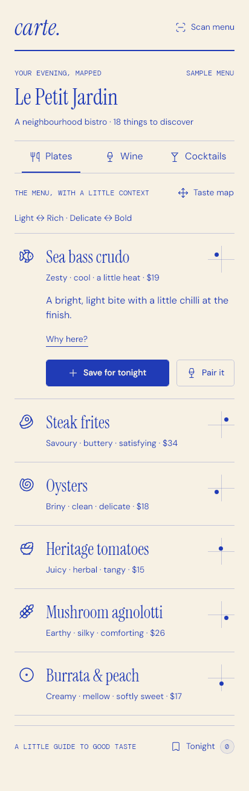
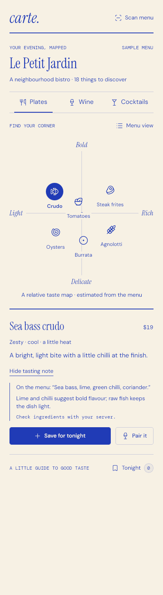
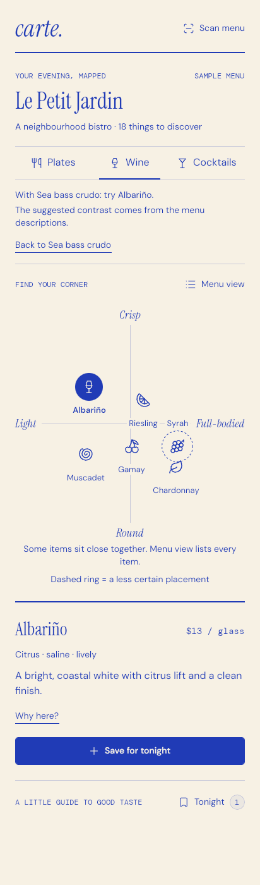
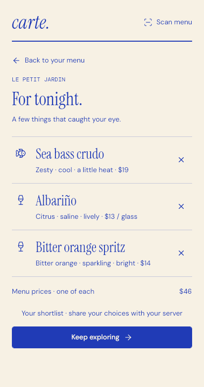
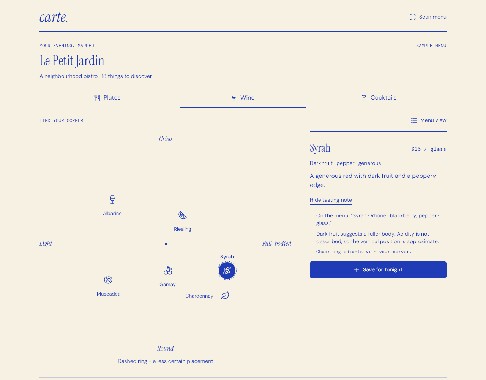

# Carte

Carte turns a restaurant menu into an illustrated taste map. This is the Uno Platform build of the **Carte Uno build kit** (`kit/`), covering the kit's Milestone one (fixture experience) and the durable parts of Milestone two.

| Menu margins | Taste atlas | Pairing | Tonight |
| --- | --- | --- | --- |
|  |  |  |  |



## Run it

```powershell
dotnet run --project Carte.Core.Checks -c Release        # 36 domain checks
dotnet run --project Carte/Carte.csproj -f net10.0-desktop
dotnet run --project Carte/Carte.csproj -f net10.0-browserwasm   # needs the wasm-tools workload
```

Uno.Sdk is pinned to 6.7.30 in `global.json`. WebAssembly builds need `dotnet workload install wasm-tools` (or `uno-check`).

## What's in the solution

| Project | Role |
| --- | --- |
| `Carte` | Uno single-project app: desktop + WebAssembly, Skia renderer, MVVM (CommunityToolkit), region navigation |
| `Carte.Core` | The kit's dependency-free core, plus `FileMenuStore`, `TasteDescriber`, `PriceFormatter`, `MapLabelLayout` and a source-generated JSON context |
| `Carte.Core.Checks` | The kit's console checks, extended from 19 to 36 |
| `kit/` | The original build kit, unchanged: specs, previews, tokens, prototype, licenses |

Read `SPEC.md` for the architecture, design and interaction briefs and the decisions behind them.

### App layout

```
Carte/
  Services/MenuSession.cs        one menu, shortlist, selection, view and pairing state
  Presentation/                  Explore, Tonight, Capture, Review pages + view models
  Controls/TasteMapView          measured quadrant; glyph buttons placed from normalized data
  Controls/ItemDetailView        description, Why here?, save, pair (panel and expanded row)
  Controls/AppHeader, EqualColumnsPanel, TextCase
  Themes/CarteResources.xaml     tokens, type ramp, button/tab/glyph templates
  Strings/en/Resources.resw      kit strings + app keys
```

## What works

- **Menu margins** (default) and **Taste atlas** are two views of one session: category, selection, rationale and pairing survive a view switch.
- Category axes come from the fixture. Data y grows upward and is flipped once, in `TasteMapGeometry`.
- Labels move to avoid glyphs, other labels and axis text; taste coordinates never move. Crowded hit targets show a note pointing to Menu view.
- Low-confidence Syrah gets a dashed ring, a legend line and "a less certain placement" in its automation name.
- Why here? shows the original menu text, the rationale and "Check ingredients with your server."
- Save for tonight toggles without duplicates; the count updates; Tonight lists saved items in menu order with a known-price subtotal (`$46` for Spritz, Crudo, Albariño) and keeps serving units (`$13 / glass`).
- Pair it selects the linked item in its category, shows "With Sea bass crudo: try Albariño." and a Back to Sea bass crudo link.
- The shortlist and reviewed menu persist per menu ID (desktop: local app data; WebAssembly: IndexedDB).
- Capture and Review are labelled illustrative screens. Read this menu can be cancelled, and a cancelled read never navigates.
- Responsive: single column below 600, centred 640 column to 904, map or menu beside a 360 detail panel from 905.

## Validation record

Environment: Linux container, .NET SDK 10.0.113, Uno.Sdk 6.7.30, Xvfb, Chromium (Playwright 1.56.1).

| Check | Result |
| --- | --- |
| `Carte.Core.Checks` | PASS: 36 domain checks |
| Desktop build (`net10.0-desktop`) | 0 errors; 5 NuGet advisory warnings from transitive `System.Security.Cryptography.*` packages |
| WebAssembly build + publish | 0 errors |
| Desktop runtime, 412 / 320 / 768 / 1280 wide | Rendered and compared with `kit/design/previews` |
| Desktop interaction (injected pointer and keyboard) | Row select and expand, Save, Why here, Pair it, view switch, map glyph select, Tonight round trip, Scan → Read → Review → Draw my taste map, Cancel read, Tab focus order and ring, Enter on focused glyph |
| Desktop restart | Shortlist restored from disk |
| WebAssembly in Chromium | Renders, Save works, shortlist survives a fresh page load; no console errors |

### Not validated here

- iOS and Android heads (not added yet; they come with camera capture).
- Screen readers, high contrast, larger system text and reduced motion on a real OS. The code paths exist (automation names, live region, `UISettings.AnimationsEnabled`), but none was exercised with assistive technology.
- Windows desktop. It should behave like the Linux Skia run, but this container can't run it.

## Debug start-state hooks

DEBUG builds read these environment variables so screenshots are deterministic:

| Variable | Effect |
| --- | --- |
| `APP_NO_HOTDESIGN=1` | Skip `UseStudio()` when no DevServer is reachable |
| `CARTE_WIDTH` / `CARTE_HEIGHT` | Resize the window |
| `CARTE_ROUTE` | `Explore`, `Tonight`, `Capture` or `Review` |
| `CARTE_VIEW=map` | Start in Taste atlas |
| `CARTE_CATEGORY`, `CARTE_SELECT`, `CARTE_PAIR`, `CARTE_WHY=1` | Pin category, selection, pairing source, open rationale |
| `CARTE_SAVE=id,id` | Seed the shortlist |
| `CARTE_FRESH=1` | Ignore the saved shortlist |

## Next milestones

1. Camera and photo-library capture behind `IMenuCaptureService` (adds iOS and Android heads).
2. OCR behind `IMenuExtractionService`, with an editable review (line correction, currency confirmation).
3. Taste analysis behind `ITasteAnalysisService`, validated against `kit/data/menu.schema.json` before it reaches the UI.

All prices and taste positions are fictional examples from the kit. Fonts (OFL) and Lucide glyphs (ISC) keep their licenses in `Carte/Assets/Licenses` and `kit/assets/licenses`.
