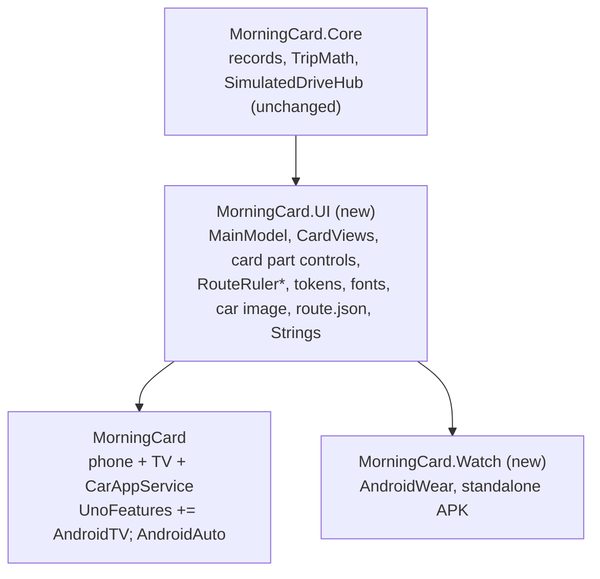

# Morning Drive Card: Uno Platform Spec

Status: ready to build, 2026-09-21. The ten original questions are resolved (see Resolved Decisions). Three small questions remain at the bottom; none blocks steps 1 to 13.
Verification: checked on 2026-09-21 against the Uno docs MCP, the `uno-platform` skill set (MVUX, Navigation, Extensions, Toolkit, Material and Skia skills), the Uno.Sdk 6.7.30 targets and build schema, and the Uno.Extensions 7.3.6 and Toolkit 9.1.3 assemblies in the local NuGet cache. Doc paths cited inline are Uno docs `sourcePath` values.
Source of truth for the design: `../MorningCard/morning-card.html` and its README (commit `97ef369`).
Targets: `net10.0-android` and `net10.0-desktop`.

The build happens in a fresh session rooted in this folder (so the project `.mcp.json` registers the `uno-app` server). That session reads this file cold.

## Goal

Port the Morning Drive Card from a single HTML file to an Uno Platform app that uses platform controls, MVUX, DI-registered services and Material theming, and that runs on Android and desktop with the same states, numbers and motion as the prototype.

The card answers one question at a glance: when do I leave for school drop-off? Fuel range, cabin temperature, tires and the car status support that answer.

## Capability Inventory

| # | Capability the design implies | Status | Note |
|---|---|---|---|
| 1 | Route time ruler (slack, drive, walk laid along a path) | implemented | `SKCanvasElement` with `SKPathMeasure`. This is the signature device and it is a schematic: minutes become distance along the path. |
| 2 | Map (ground under the route, school pin) | **substituted by decision** | The card is the whole sample, so there is no real map anywhere. The ground is a Skia schematic: the slack stretch has no geographic meaning (the car is parked during slack), so a real map could not carry the ruler unchanged. Mapsui was added, verified to build against the bundled SkiaSharp 3.119.2, and removed as unused. |
| 3 | Live trip data (drive time, traffic delay, usual time) | **substituted (decided)** | No routing endpoint exists. `ITripService` contract plus a simulated implementation with latency and failure injection. |
| 4 | Live vehicle telemetry (range, cabin, tires, lock, plug, last seen) | **substituted (decided)** | No vehicle API credentials exist. `IVehicleService` contract plus the same simulated hub. |
| 5 | Remote commands (lock, climate, send destination to car) | **substituted (decided)** | Commands go to the simulated hub. The tuning panel is titled "Simulator" so the surface stays honest. |
| 6 | Clock-driven recompute (slack shrinks as time passes) | implemented | `TimeProvider` plus a minute-aligned tick feed. The prototype only moved time through a slider. |
| 7 | Loading, empty, offline states | implemented | `FeedView` templates plus visual states. Built with the `uno-component-states` process: populated card first, then transformed. |
| 8 | Light and dark theme, runtime toggle | implemented | Material theme, `ThemeService`, token dictionaries with Light and Dark entries. |
| 9 | Dialable accent hue, corner radius, motion speed | implemented | Debug tuning surface writes brush colors, a radius resource and a motion multiplier. |
| 10 | Frosted glass card over a blurred backdrop | implemented, technique pending spike R2 | First choice is the platform's Skia-native `AcrylicBrush`, then a `SaveLayer` backdrop filter, with a translucent fill over the pre-blurred bokeh as the floor. |
| 11 | Navigation from the title chevron and the tires chevron | **omitted by decision** | Nothing sits behind the card, so both chevrons keep their look and do nothing. Listed in the README's known gaps. |
| 12 | "More" action | **omitted (decided, logic later)** | Keeps its look, does nothing. Listed in the README's known gaps. |
| 13 | Charging state | implemented | `IsPluggedIn` and `ChargePercent` on the snapshot, driven from the Simulator. |
| 14 | Localization and units | implemented for English, **French and a units switch omitted (decided)** | `Localization` UnoFeature, `.resw`, `x:Uid` from day one, `en` only. Units stay miles, °F and psi. |
| 15 | Reduced motion | implemented on Android, **substituted on desktop (accepted)** | `UISettings.AnimationsEnabled` is hardcoded `true` on Skia desktop, so a Reduced motion switch in the Simulator stands in for the OS setting there. |
| 16 | Accessibility (pressed state, names, focus, live region) | implemented on desktop, **at risk on Android (accepted)** | `ToggleButton`, `AutomationProperties`, focus visuals. Upstream marks Android Skia TalkBack as WIP; one device pass, result recorded. |

## Architecture Brief

### Decisions

```
Decision: MVUX for the page model.
Reason: the card is fed by two async services, has loading, none and error states, and pushes
        live updates (clock ticks, telemetry). FeedView owns those states; commands generate
        from model methods. That is the MVUX default case in uno-scaffolding.md.
Tradeoff: bindings inside FeedView templates use {Binding Data.X} and {Binding Parent.X},
          with no x:Bind compile-time checking on the data surface.
```

```
Decision: the route ruler and map ground are one SKCanvasElement.
Reason: three needs have no XAML or Composition equivalent: point-at-length along the path
        (node, dot, pill and label positions), label text with a halo stroke, and about forty
        slack dots, nodes and labels on one entrance timeline. SKPathMeasure covers positions
        and partial segments in one place. SKCanvasElement is supported on desktop and on
        net10.0-android with the SkiaRenderer feature (controls/SKCanvasElement.md).
Alternative considered: a hybrid. Partial segments alone are doable without Skia:
        CompositionGeometry.TrimStart/TrimEnd is implemented on Skia (SKPathEffect.CreateTrim)
        and Path.StrokeDashOffset is implemented too. The hybrid still needs SKPathMeasure for
        every position and gives up the halo, so it splits one drawing across two systems.
Tradeoff: labels drawn in Skia are invisible to the automation tree, so the element carries one
          composed AutomationProperties.Name sentence. XAML Opacity does not affect the
          element, so alpha is baked into paints.
```

```
Decision: everything else on the card is XAML controls.
Reason: header, ETA block, stats and actions are text, buttons and a progress bar. They need
        theming, focus, automation peers and localization, which controls provide for free.
Tradeoff: two rendering systems share one palette, so the palette is snapshotted into the Skia
          renderer on theme change and on hue change.
```

```
Decision: offline is a value, not a feed error.
Reason: the design shows stale data with "Last seen 6:58", dimmed stats and a Retry link.
        FeedView.ErrorTemplate replaces the content and its DataContext is the Exception,
        so stale data could not render there. VehicleSnapshot carries IsStale and LastSeen.
Tradeoff: a true failure with no cached snapshot still needs an ErrorTemplate (card-shaped,
          with Retry). Two paths to test.
```

```
Decision: the dials never touch the card. They write to the simulated hub; the card reads feeds.
Reason: same contract as the prototype ("the card never reads from the dials"). Swapping the
        hub for real services later changes registrations only.
Tradeoff: a slider drag travels hub -> feed -> FeedView, a longer path than a direct binding.
          Verify drag latency stays under one frame budget on Android.
```

```
Decision: the card shadow is drawn by a Skia element, with the card's rounded rect clipped out.
Reason: ShadowContainer was the first choice and fails this design by construction. Toolkit
        9.1.3 PaintInner draws each drop shadow as a full blurred round rect, clips to the
        content, then paints the background over it. Under a 74 percent alpha glass the
        0 30 60 -30 layer darkens the lower card interior. CSS box-shadow never paints under
        the box. CardShadowCanvas draws both layers and clips with SKClipOperation.Difference.
        Its colors come from the same palette snapshot as the ruler, which also sidesteps
        ThemeResource on utu:Shadow (a DependencyObject) for the per-theme shadow colors.
Tradeoff: one more SKCanvasElement, sized 60 epx beyond the card on every side because
          drawing is clipped to the element area. ShadowContainer stays the choice for any
          opaque surface added later.
```

```
Decision: the card container is a Border, with the glass as a childless sibling Border behind
          the content.
Reason: the toolkit-card skill prescribes CardContentControl for card surfaces. This surface is
        non-interactive (no state layer, no ripple), ElevatedCard would add a second shadow,
        and the documented Skia AcrylicBrush path requires a childless element on Android.
Tradeoff: no Material card semantics. If the card ever becomes tappable as a whole, move to
          FilledCardContentControlStyle with a transparent FilledCardContentBackground.
```

```
Decision: the accent hue dial mutates the app's Accent SolidColorBrush instances in place.
Reason: the design defines accent as hsl(h 82% 52%). SemanticThemeHelper.PrimarySeed derives
        HCT tones that do not equal those values, and an OverrideSource entry freezes Primary
        against the seed anyway.
Tradeoff: Material controls in the tuning panel (Slider, Chip) read Primary brushes, so their
          lightweight-styling keys point at the app AccentBrush resources to follow the dial.
```

### Solution structure

Mirror `C:\Users\Platform006\UnoProjects\DYT` (same TFMs, Uno.Sdk 6.7.30, a Core library, xunit tests).

```
SampleBuilds/MorningCard.Uno/
  SPEC.md
  .mcp.json                     copied from ~/.claude/templates/uno/.mcp.json before first build
  global.json                   Uno.Sdk 6.7.30
  MorningCard.sln
  MorningCard/                  app head, net10.0-android;net10.0-desktop
    App.xaml(.cs)               host builder, routes, theme
    appsettings.json            embedded; LocalizationConfiguration cultures
    Presentation/
      MainPage.xaml             stage: backdrop, card, tuning region
      MainModel.cs              partial record, MVUX
      TuningPanel.xaml          UserControl view, nested default route ("Simulator")
      TuningModel.cs            partial record, MVUX, dials
      TripPage.xaml             NavigationBar, Mapsui MapControl, trip summary strip
      TripModel.cs              partial record, MVUX
    Controls/
      MorningCardView.xaml      UserControl, the card
      RouteRulerCanvas.cs       SKCanvasElement + DPs
      RouteRulerRenderer.cs     pure drawing, no XAML types
      CardShadowCanvas.cs       SKCanvasElement, two shadow layers, card rect clipped out
      BokehBackdrop.cs          SKCanvasElement, four blurred blobs
    Motion/                     entrance timeline, easing, reduced-motion probe
    Themes/
      ColorPaletteOverride.xaml Material role overrides (Dsp feature stays off)
      CardTokens.xaml           app tokens with Light and Dark theme dictionaries
      FontOverride.xaml         MaterialLight/Regular/MediumFontFamily -> Instrument Sans
      Fonts.xaml                app FontFamily resources (manifest first, per-weight fallback, R10)
      Styles/                   RoundActionButton, StatCell, TuningChip, LinkButton
    Strings/en/Resources.resw   English only in this version
    Assets/Fonts/               Instrument Sans static TTFs 400/500/600/700
  MorningCard.Core/             net10.0, no Uno references
    Models/                     TripPlan, VehicleSnapshot, TripTimeline, RouteFractions, enums
    TripMath.cs                 port of derive() and the level rules
    RouteLayout.cs              port of the fraction math from drawRoute()
    Services/                   ITripService, IVehicleService, SimulatedDriveHub
  MorningCard.Tests/            xunit 2.9.2, targets Core
```

UserControl for the card: one consumer, fixed composition. A templated control adds a generic.xaml and template parts nobody needs yet.

### Pinned versions

| Item | Version | Source |
|---|---|---|
| .NET SDK | 10.0.303 | installed |
| Uno.Sdk | 6.7.30 (latest stable on NuGet, 2026-09-21) | DYT `global.json` |
| Uno.Extensions | 7.3.6, implicit from the SDK | local NuGet cache for 6.7.30 |
| Uno.Toolkit.Skia.WinUI | 9.1.3, implicit | the SDK references it when `Toolkit` and `Skia` are both in UnoFeatures (`Uno.Implicit.Packages.ProjectSystem.targets`); no explicit PackageReference. DYT needs one only because it omits `Skia`. |
| SkiaSharp | bundled 3.119.x | no v4 feature is needed; do not opt in |
| xunit / runner / Test.Sdk | 2.9.2 / 2.8.2 / 17.12.0 | DYT tests |
| Microsoft.Extensions.TimeProvider.Testing | latest stable at scaffold time | `FakeTimeProvider` for the clock tests |
| Mapsui.Uno.WinUI | 5.1.0 | NuGet. Dependencies align with the SDK on paper; runtime on both heads is spike R1. Added in step 12, so a failed spike cannot block the card. |

UnoFeatures, every name verified against `uno.sdk/6.7.30/Sdk/Sdk.props.buildschema.json`:
`Material; Toolkit; Extensions; Hosting; Configuration; Localization; Navigation; MVUX; Logging; ThemeService; SkiaRenderer; Skia`.
`SkiaRenderer` alone brings `Uno.WinUI.Graphics2DSK` (`SKCanvasElement`) on both heads; `Skia` stays for the implicit Toolkit Skia package. `Extensions` already covers Hosting, Configuration and Logging; the explicit names stay because they are harmless and self-documenting. `Http` stays out while the services are simulated; it arrives with the first real endpoint.

Scaffold command (dry run passed, creates Android and desktop only):

```
dotnet new unoapp -o MorningCard -preset recommended -platforms android desktop -presentation mvux -theme material -theme-service -renderer skia -tfm net10.0 -http none -dsp false -tests none
```

- The installed `Uno.Templates` is 7.0.0-dev.6 and may emit a 7.0-dev `global.json`. Install the templates matching Uno.Sdk 6.7, or diff the generated project against DYT, then pin 6.7.30.
- `-dsp false` keeps `ColorPaletteOverride.xaml` hand-authored. With Dsp on, the file is regenerated from json on every build.
- Set `SupportedOSPlatformVersion` for Android to 24.0 (the SDK default is 21.0; DYT uses 24.0).
- Follow whichever Material wiring the scaffold emits. Themes 7.1.1 prefers `<utum:MaterialToolkitTheme.Colors><ut:ThemeColors OverrideSource="..."/></utum:MaterialToolkitTheme.Colors>`; `ColorOverrideSource` is deprecated and still works. `FontOverrideSource` points at `Themes/FontOverride.xaml`.
- If Android `Release` restore fails on `Microsoft.NETCore.App.Runtime.Mono`, run `dotnet workload update`.

### State model

Core records (immutable, `partial` where they carry an `Id`):

```csharp
public enum TrafficLevel { Light, Moderate, Heavy }       // delay <= 1, <= 6, else
public enum CardTone { Ok, LeaveNow, Late }               // slack >= 2, 0..1, < 0
public enum StatLevel { Normal, Warn, Bad }

public record TripPlan(string Title, TimeOnly Bell, int BaseDriveMin, int UsualDriveMin,
                       int DelayMin, int WalkMin);

public record VehicleSnapshot(string Name, bool IsLocked, bool ClimateOn, int CabinTemp,
                              int Range, int RangeMax, int TireFrontLeftPsi,
                              bool IsPluggedIn, int ChargePercent,
                              bool IsStale, TimeOnly LastSeen);

public record GeoPoint(double Longitude, double Latitude);
public record TripRoute(GeoPoint Home, GeoPoint School, IReadOnlyList<GeoPoint> Line);  // sample data

public record TripTimeline(int DriveMin, TimeOnly LeaveBy, int SlackMin, bool IsLate,
                           TimeOnly Start, TimeOnly Arrive, int TotalMin, CardTone Tone,
                           TrafficLevel Traffic, int VsUsualMin);

public record RouteFractions(double Leave, double Arrive, int SlackVisibleMin);
```

`TripMath.Derive(TripPlan, TimeOnly now)` is a line-for-line port of `derive()`:
`drive = base + delay; leaveBy = bell - walk - drive; slack = leaveBy - now; late = slack < 0; start = late ? now : leaveBy; arrive = start + drive`.
`RouteLayout.Fractions` ports `slackVis = late ? 0 : min(slack, 12); T = slackVis + drive + walk; fLeave = slackVis / T; fArrive = (slackVis + drive) / T`.
Thresholds: range warn < 70, bad < 30, bar width `max(2, 100 * range / rangeMax)` percent; tire warn < 30 ("FL low"), bad < 26 ("FL {n} psi").

`MainModel` (partial record, services by constructor):

| Member | Type | Source |
|---|---|---|
| `Now` | `IFeed<TimeOnly>` | `Feed.AsyncEnumerable(hub.WatchClock)`. One source: the hub merges the minute-aligned `TimeProvider` tick with the Clock dial override, because a feed cannot be reassigned |
| `Trip` | `IFeed<TripPlan>` | `ITripService.Watch()`; None means no drop-off today |
| `Vehicle` | `IFeed<VehicleSnapshot>` | `IVehicleService.Watch()` |
| `Timeline` | `IFeed<TripTimeline>` | `Feed.Combine(Trip, Now)` projected through `TripMath.Derive` |
| `ToggleLock`, `ToggleClimate`, `SendToCar`, `Retry` | generated commands | call the services; read current values with `await Vehicle` inside the method, never through `CommandParameter` from a FeedView template |

`SendToCar` awaits the service, sets a `SendConfirmed` `IState<bool>` to true and returns. The 1400 ms reset runs outside the command (a timer owned by the model), because a generated command stays in its executing state, and its button disabled, for as long as the method runs.

`Feed.Combine` fast-starts to None when a parent is None (`CombineFeedHelper.fastStartForNone`), so `Timeline` is None on a no-trip day while `Vehicle`, a separate feed, stays live. A null from `Watch()` is the documented None signal. Confirm the `NoneTemplate` path in spike R9.

Every `Watch(CancellationToken)` iterator marks its token `[EnumeratorCancellation]`; MVUX cancels it when the last subscription ends.

`TuningModel` holds `IState<T>` per dial, two-way bound with `{Binding X, Mode=TwoWay}`, each forwarding to the hub or to the theme tokens through `State.Value(this, ...).ForEach(...)`. `IState<int>` and `IState<double>` only; no nullable value types.

```
Decision: the tuning panel is its own view (TuningPanel UserControl + TuningModel), hosted in a
          ContentControl region on MainPage through a nested default route.
Reason: ViewMap<TView, TModel> gives one model per view, and a TuningModel exposed as a plain
        property of MainModel would hand XAML raw IState objects with no bindable proxy. A region
        keeps construction in DI and keeps simulator state out of the card's model. If the panel
        ever becomes DEBUG-only, the route registration is the single switch.
Tradeoff: one more route and a region for a panel that never navigates. Fallback if the region
          misbehaves: DataContext = ActivatorUtilities.CreateInstance<TuningViewModel>(services),
          the DYT convention.
```

`MorningCardView` inherits the page DataContext (`MainViewModel`) and has no model of its own.

Known MVUX traps to respect (from `uno-scaffolding.md`): no feed or state named `Model`; records with `required` members or `record struct` values break bindable generation; a Retry button inside `ErrorTemplate` binds with `ElementName` to the named `FeedView`; equal records are deduped, so every hub push must differ in value.

### Navigation model

`Uno.Extensions.Navigation`, region-based, routes registered centrally in `App.xaml.cs`. No code-behind navigation. Three routes: Main (default), its nested Tuning region, and Trip.

The scaffold (step 1, done) is shell-less: the generated `App.xaml.cs` calls `MainWindow.InitializeNavigationAsync(() => Task.FromResult(builder.Build()), initialRoute: "Main")` and registers flat routes. Existing project code wins for local conventions, so the app keeps that shape. There is no `Shell.xaml` and no `ShellModel`. The ViewMap names the model record and `ReactiveViewModelMappings.ViewModelMappings` bridges it to the generated ViewModel.

```csharp
views.Register(
    new ViewMap<MainPage, MainModel>(),
    new ViewMap<TuningPanel, TuningModel>(),
    new ViewMap<TripPage, TripModel>());

routes.Register(
    new RouteMap("Main", View: views.FindByViewModel<MainModel>(), IsDefault: true, Nested:
    [
        new RouteMap("Tuning", View: views.FindByViewModel<TuningModel>(), IsDefault: true)
    ]),
    new RouteMap("Trip", View: views.FindByViewModel<TripModel>()));
```

If forward and back navigation between two root routes misbehaves without a shell host (5 minute check in step 14), add the Shell from the DYT convention: `new ViewMap(ViewModel: typeof(ShellModel))`, a root `RouteMap("")` with these routes nested, and `builder.NavigateAsync<Shell>()`. `Shell` carries no `Region.Attached`.

The title button navigates in XAML with `uen:Navigation.Request="Trip"`. `TripPage` has a `utu:NavigationBar` whose back button returns to Main. `TripModel` reads the same `ITripService` and `Now` sources, so the page needs no navigation data. The tires cell and the More button carry no request and no command in this version.

Trip page (capability 2): Mapsui `MapControl` filling the page under the NavigationBar, `OpenStreetMap.CreateTileLayer(userAgent)`, the route as a `MemoryLayer` line in Accent (Red when late), home and school `PointFeature` pins, initial view fitted to the route extent with padding, pan and zoom enabled. A summary strip under the bar repeats leave-by, drive time and arrival from `TripTimeline`. `TripRoute` comes from `ITripService.GetRouteAsync` and is fixed sample data. Without a network the tiles stay blank and the route line still draws; the strip says "Map tiles unavailable offline." in that case.

Host builder chain: keep the generated order (`UseLogging`, `UseConfiguration(...EmbeddedSource<App>().Section<AppConfig>())`, `UseLocalization()`, `ConfigureServices`, `UseNavigation(ReactiveViewModelMappings.ViewModelMappings, RegisterRoutes)`). Configuration must stay ahead of `UseLocalization()`, because `LocalizationService` takes `IOptions<LocalizationConfiguration>` and `IWritableOptions<LocalizationSettings>`. The scaffold was generated with `-theme-service` and emits no `UseThemeSwitching()` call; add it before `UseNavigation` in step 5 and confirm `IThemeService` resolves (the documented registration call, Chefs `ThemeService.md`).

`appsettings.json` (embedded) declares `"LocalizationConfiguration": { "Cultures": [ "en" ] }`; the `Strings/` folder names match those entries exactly. Adding French later means a `Strings/fr` folder plus `"fr"` in that list (`fr` serves fr-CA devices through resource fallback), and a culture change applies on the next app start.

Theme: inject `IThemeService` (`Uno.Extensions.Toolkit`), toggle with `await SetThemeAsync(AppTheme.Dark)`. The service persists the choice, and the window root does not exist before `InitializeNavigationAsync` returns, so the `MC_THEME` hook applies after navigation and overrides the saved value. In `TuningModel`: `State.Value(this, () => _theme.Theme).ForEach(async (t, ct) => await _theme.SetThemeAsync(t))`.

### Services and data flow

```
TuningModel (dials) --> SimulatedDriveHub --> ITripService.Watch() / IVehicleService.Watch()
                                                   |
TimeProvider ----------> Now feed -----------------+--> MainModel feeds --> FeedView --> MorningCardView
                                                                                  |
MorningCardView commands --> MainModel methods --> IVehicleService ---------------+
```

- `ITripService`: `IAsyncEnumerable<TripPlan?> Watch(CancellationToken)`, `ValueTask<TripRoute> GetRouteAsync(CancellationToken)`, `ValueTask RefreshAsync(CancellationToken)`.
- `IVehicleService`: `IAsyncEnumerable<VehicleSnapshot> Watch(...)`, `SetLockedAsync`, `SetClimateAsync`, `SendDestinationAsync`, `RefreshAsync`.
- `SimulatedDriveHub`: singleton registered for both interfaces. Holds the knobs, a connection mode (Live, Loading, Offline, NoTrip), 400 to 800 ms command latency, and a failure switch so one error and one retry can be driven before the second surface is built.
- `TimeProvider.System` registered as a singleton; tests use `FakeTimeProvider`.
- Registrations use plain `AddSingleton` overloads. If `AddHttpClient<T>` arrives later, use the parameterless overload (the factory-lambda trap in `uno-scaffolding.md`).

### Platform constraints

- Both heads use the Skia renderer, so `SKCanvasElement` is supported on both. Keep the `IsSupportedOnCurrentPlatform()` guard with a plain fallback panel.
- Android: edge-to-edge is on by default (.NET 9+, SDK 35+) and enforced on Android 15+. `utu:SafeArea.Insets="Left,Top,Right,Bottom"` goes on the ScrollViewer content, so `BokehBackdrop` stays full-bleed. On the Page: `utu:StatusBar.Foreground="Auto"` (an enum: Light, Dark, Auto, AutoInverse) and `utu:StatusBar.Background="{ThemeResource GroundBrush}"`; both are no-ops on desktop.
- Android back: the gesture exits the single page. On Android 16+ `Handled` is ignored and any live `BackRequested` subscription consumes back presses (`features/hardware-back-button.md`); check on an API 36 image whether `Uno.Extensions.Navigation` holds one.
- Android accessibility: the docs status table marks "Android Skia TalkBack" as WIP (`features/accessibility/index.md`). Names and the live region are set on both heads and verified on desktop; TalkBack is tested on the device and recorded as a gap if it fails.
- Desktop: gate `MainWindow.UseStudio()` behind `APP_NO_HOTDESIGN`; never enter Hot Design with this app (the primary surface is an `SKCanvasElement`). Window size: `MainWindow.AppWindow.Resize(...)` before `NavigateAsync` is the documented route (`features/windows-ui-xaml-window.md`), and `uno-scaffolding.md` records intermittent clipped first frames with it. Do not resize; the 400 max width makes the card independent of window size, and captures pin content size instead.
- `CompositionEffectBrush` painted nothing on Skia desktop when measured on Uno.Sdk 6.6.42. The docs describe a Skia-native `AcrylicBrush` path that avoids it (R2). No other Composition blur.
- Reduced motion: `UISettings.AnimationsEnabled` is real on Android and hardcoded `true` on Skia desktop (`UISettings.cs`, release/stable/6.7). A Reduced motion switch in the tuning panel is the desktop source; on Android the two are OR-ed.
- Storyboards: only `Opacity` and a single Translate, Rotate, Scale or Composite transform are GPU-bound; no `TransformGroup`, one transform property per animation, no shared Transform or Animation resources (`features/working-with-animations.md`). Width changes are dependent animations.
- A held `CompositionTarget.Rendering` subscription costs 50 to 70 percent of a core. The entrance subscribes once and unsubscribes on completion; the skeleton pulse runs on a 30 fps `DispatcherTimer` and stops on state exit.
- Render thread rules: renderer reads plain snapshot fields; paints, paths, typefaces and `SKPathMeasure` are created once and reused; nothing allocates per frame.
- Fonts: static Instrument Sans TTFs (variable fonts are "not supported on Skia", `features/custom-fonts.md`), Content build action, `ms-appx:///Assets/Fonts/File.ttf#Internal Family Name`, internal names verified from the `name` table (reuse `UnoBusiness/scripts/05-fetch-fonts.ps1`). First choice is the documented `.ttf.manifest` font manifest that maps `FontWeight` to static files, so one `FontFamily` serves all four weights; fallback is one `FontFamily` resource per weight (R10). `FontOverride.xaml` supplies `MaterialLightFontFamily`, `MaterialRegularFontFamily` and `MaterialMediumFontFamily`, otherwise Slider, Chip and Button text stays Roboto. The same files load as `SKTypeface` for the canvas labels (R11).

### Testing and validation

- Unit tests (Core): `TripMath` for the default case (now 7:24, bell 7:50 gives slack 9, leave 7:33, arrive 7:47, total 17), slack 1 (LeaveNow), now 7:40 (Late, no slack fraction), slack cap 12, traffic boundaries 1/2 and 6/7, vs-usual faster, slower and equal, range and tire thresholds, bar floor of 2 percent. `RouteLayout` fractions sum and ordering.
- Runtime: `uno-verify` loop on desktop with the App MCP; Android smoke on day one.
- DEBUG env hooks pin the start state without a pointer: `MC_STATE` (live, loading, offline, empty), `MC_CLOCK` (minutes since midnight), `MC_THEME`, `MC_DELAY`.
- Parity: capture each state at 390 epx wide in light and dark and compare against headless captures of the HTML at the same state.
- Two widths (390, 1280) and two heights (844, 600).

## Design Brief

### Visual direction

Frosted glass card over an out-of-focus morning backdrop. Blue-biased ink, one route accent with a dialable hue, semantic green, amber and red kept apart from the accent. One type family.

### Tokens

`CardTokens.xaml`, Light and Dark theme dictionaries, consumed with `ThemeResource` on standard properties. No hex in pages or controls.

| Token | Light | Dark |
|---|---|---|
| Ground | #D9D6D0 | #10151C |
| BlobA / B / C / D | #D9B37A / #A9C4DD / #8F9AA6 / #F1E6D2 | #5A4322 / #23405A / #2C3540 / #3A3126 |
| Glass | white 74% | #181E26 72% |
| GlassEdge | white 70% | white 14% |
| Glass2 (tuning panel) | white 55% | white 6% |
| Ink / Ink2 / Ink3 | #1B2430 / #5B6570 / #98A1AB | #F0F3F6 / #A9B3BD / #6F7A86 |
| Line | #1B2430 10% | white 10% |
| Accent / AccentInk / OnAccent | hsl(h 82% 52%) / hsl(h 70% 42%) / #FFFFFF | hsl(h 90% 66%) / hsl(h 90% 72%) / #0F151C |
| Good / GoodInk | #1F8A5B / #1B7A51 | #3CCF8A / #5FDC9E |
| Amber / AmberInk | #E8931C / #B8690A | #F0A63A / #F5BD66 |
| Red / RedInk | #D9453A / #B7352C | #EF6A5F / #F58A80 |
| Map / MapRoad / MapPark / MapWater / Pin | #ECEFEC / #FFFFFF / #D6E7CF / #BCD7F2 / #3A424B | #1A222B / #26303B / #1F3328 / #223D5C / #E6EBF0 |
| Chip | #1B2430 6% | white 8% |

Default hue 218. Material role mapping in `ColorPaletteOverride.xaml`: Primary = Accent, OnPrimary = OnAccent, Surface and Background = Ground, OnSurface = Ink, OnSurfaceVariant = Ink2, Outline = Ink3, Error = Red. Good and Amber stay app tokens.

Hue dial: compute the four accent colors with an HSL helper and assign them to the shared `SolidColorBrush` instances, then push a new palette snapshot to the canvas.

### Typography

Instrument Sans, weights 400, 500, 600, 700. Named `TextBlock` styles in `Themes/`, each `BasedOn` a Material type-scale key (Themes 7.1.1: `Display|Headline|Title|Body|Label` x `Large|Medium|Small`, plus `LabelExtraSmall` and `CaptionLarge|Medium|Small`) with `FontSize`, `FontWeight` and `FontFamily` setters. That file is the one place that sets sizes; pages never do.

| Style | Size | Weight | BasedOn | Used for |
|---|---|---|---|---|
| EtaNumber | 42 | 700 | DisplayMedium | ETA minutes |
| CardTitle | 23 | 600 | TitleLarge | "School drop-off" |
| EtaUnit | 18 | 600 | TitleMedium | "min" |
| StatValue | 16 | 600 | TitleMedium | stat values |
| CardBody | 15 | 400 | BodyLarge | subtitle, arrival |
| CardLabel | 14 | 400 / 600 | BodyMedium | greeting, traffic level |
| ActionLabel | 13 | 400 / 500 | LabelLarge | action labels, tuning text |
| Caption | 12.5 | 400 | BodySmall | captions, car status, secondary lines |

Canvas text (11.5 map labels, 12 pill) is drawn by Skia from the same font files.
Title: weight 600, line height 1.15. ETA: weight 700, line height 1.0.
`CharacterSpacing` is a no-op on the Skia text stack, so the -0.02em and -0.03em tracking on the title and ETA is dropped. Tabular numerals depend on R5.

### Layout

- Stage: `ScrollViewer`, content max width 400 (824 in the two-column state), 16 side padding, 36 top, 56 bottom, 24 between card and tuning panel. Use star columns with `MaxWidth`, never a centered content-sized panel.
- Card: padding 22, 18 between sections, corner radius 34 (dialable 12 to 44), 1 px GlassEdge border. Shadow: two layers, `0 30 60 -30` at #141C28 45% and `0 2 6 0` at #141C28 8% (dark: black 80% and 30%).
- Header: grid `*` and 92, gap 10. Left: greeting row (18 sun icon, 8 gap), title button with 14 chevron at 6 gap, subtitle. Right: car illustration 92 by 42, name (12.5, weight 500, Ink), status (12.5, Ink2).
- Map panel: height 214, corner radius 20, 1 px Line border, Map fill, clipped. Canvas fills the panel and scales the 356 by 214 design space uniformly to fill, centered. ETA block overlays top-left at 16, 14 with max width 54 percent. A left-to-right fade of the Map color from 92 percent to 0 at 55 percent width sits under the ETA block, drawn in the canvas.
- Route path (design space): `M34 186 L102 180 Q140 178 164 160 L200 130 Q222 112 244 88 L258 74 Q268 62 276 56`. Segment stroke 5, round caps. Slack dots radius 2.1, step 7, from 12 after the start to 10 before the leave node. Car dot radius 6.5 with 3 white stroke, glow radius 14 at 18 percent. Nodes radius 5 (bell node 4, Amber) with 2.5 white stroke. Drive pill 58 by 24, radius 7, centered at the drive midpoint plus (30, 32). Pin with an 18 leader above the bell node. Labels: points above the path, durations below; the Leave label moves below the path when the gap from Now to Leave is 84 or less, and the slack caption hides in that case. Label halo: 3 px stroke in the Map color under the fill.
- Stats: three columns 1.05*, 1*, 1.05*, Line dividers, cell padding 9 left and 8 right. Icon 20, value 16 weight 600, caption 12.5 Ink2. Range bar spans the first cell: height 6, radius 3, Chip track, 10 above. Tires cell is a button with a 12 chevron.
  Charging cell: unplugged shows "—" over "Not charging", as in the prototype. Plugged in shows "{n}%" over "Charging", value and icon in GoodInk; at 100 the caption reads "Charged".
  Fix the prototype defect here: at 390 wide "All good" collides with the chevron. Give the chevron its own 12 px column and let the value trim.
- Actions: four equal columns, gap 6, top padding 4. Circle 56, corner radius 28 (half the height; an oversized radius renders oval on Skia), Chip fill, icon 24 with 1.7 stroke. Label 13, secondary line 12.5 Ink2, 8 under the circle.
- Subtitle fix: the default sentence wraps to two lines at 390. Accept the wrap, and reserve two lines of height so the map does not jump between states.

### Component hierarchy

```
MainPage
  BokehBackdrop                      SKCanvasElement, full-bleed, behind everything
  ScrollViewer > Grid (SafeArea insets, star columns, MaxWidth by visual state)
    MorningCardView                  UserControl
      CardShadowCanvas               SKCanvasElement, margin -60, card rect clipped out
      Border (glass)                 childless, AcrylicBrush per R2, radius, GlassEdge border
      Grid (content)
        Header                       TextBlocks, title Button, car illustration (Paths in a Viewbox)
        MapPanel (Border, clipped)
          RouteRulerCanvas           SKCanvasElement
          mvux:FeedView (Timeline)   Value: ETA block, Progress: skeleton, None: "No drop-off today"
        Stats                        Grid, ProgressBar, Button
        Actions                      ToggleButton x2, Button x2
    ContentControl (uen:Region)      hosts TuningPanel
      TuningPanel ("Simulator")      utu:ChipGroup, Slider x9, ToggleSwitch x2, Button x2
TripPage
  utu:NavigationBar                  back to Main
  Summary strip                      leave-by, drive, arrival
  mapsui:MapControl                  OSM tiles, route line, home and school pins
```

Simulator controls: state chips (Live, Loading, Offline, No trip); sliders for Clock, Traffic delay, Range, Cabin temperature, Front-left tire, Charge, Route hue, Corner radius, Motion speed; switches for Plugged in and Reduced motion; buttons for Replay entrance and Toggle theme. The Charge slider is enabled only while Plugged in is on.

- Icons are stroked `Path` elements inside a `Viewbox`, with data copied from the SVGs. `SvgImageSource` and Resizetizer output render as images with no stroke recolor, and `PathIcon` is fill-only and clips. All arcs in the source icons are circular, which the Uno path parser requires. `Path.Stroke` does not inherit `Foreground`: inside the button styles bind `Stroke` to the templated parent's `Foreground` so icons follow checked and disabled states.
- Lock and Climate base on Material's `IconToggleButtonStyle` with `Width` and `Height` 56 and `CornerRadius` 28. Lightweight keys: `IconToggleButtonBackground` (Chip), `IconToggleButtonBackgroundChecked` plus its `CheckedPointerOver`, `CheckedPressed`, `CheckedDisabled` variants (Accent), `IconToggleButtonForegroundChecked` plus variants (OnAccent). `ut:ControlExtensions.AlternateContent` holds the open-shackle icon for the unchecked lock. Verify the template honors `CornerRadius`; retemplate only if it does not.
- State chips: `utu:ChipGroup SelectionMode="Single"` with `Style="{StaticResource FilterChipGroupStyle}"` (an unstyled Chip renders bare; Material has no segmented style, only Cupertino ones). `ItemsSource` is the four connection modes, `SelectedItem="{Binding Mode, Mode=TwoWay}"` on an `IState<ConnectionMode>`. No `.Selection()` operator for a static list.
- `ProgressBar` carries the range so the value reaches automation. Material 7.1.1 exposes `ProgressBarBackground`, `ProgressBarForeground`, `ProgressBarHeight` and `ProgressBarMinWidth` only: colors and the 6 px height are reachable, the 3 px radius depends on the template binding `CornerRadius`, and the 2 percent floor is applied to the bound value in the model (R4).
- Focus visuals are `FrameworkElement` properties set in each interactive style: `UseSystemFocusVisuals="True"`, `FocusVisualPrimaryBrush="{ThemeResource AccentBrush}"`, `FocusVisualPrimaryThickness="2"`, `FocusVisualSecondaryThickness="0"`, `FocusVisualMargin="-3"`. The ring follows the control's `CornerRadius`; there is no separate focus radius. Material paints its own focused overlay (`IconToggleButtonStateCircleOpacityFocused`), so set that opacity key to 0 to avoid a double indicator.

### Theme usage

Material theme through the `Material` UnoFeature. `ThemeService` drives the runtime toggle. The canvas re-snapshots its palette on `ActualThemeChanged`.

### Responsive behavior

- Under 900 epx wide: single column, card then tuning panel, page scrolls.
- 900 and over: two columns, card left (400), tuning panel right (400), 24 gap, both top-aligned, centered as a pair. A `VisualStateManager` state with `AdaptiveTrigger MinWindowWidth="900"` sets the tuning region's `Grid.Row` and `Grid.Column` and the stage `MaxWidth` (400 to 824). Docs guidance: visual states for structure changes, `utu:Responsive` for property values; its default `Wide` breakpoint is 800 and its use on attached properties is undocumented. `ResponsiveView` is ruled out because it swaps templates, which would recreate the card and replay the entrance.
- Android landscape gets the two-column layout when width allows; otherwise it scrolls. No fixed heights outside the 214 map panel.

## Interaction Brief

### User flows

1. Open the app. Read the leave-in sentence, glance at the route.
2. Lock, Climate, Send to car. More is inert in this version.
3. Tap the title to open the Trip page: pan and zoom the real route, read the summary strip, go back. The tires cell is inert in this version.
4. Simulator: switch connection mode, drag dials, plug the car in, replay the entrance, toggle the theme.

### Headline logic

| Condition | Subtitle | Tone |
|---|---|---|
| slack >= 2 | "Leave in {n} min to arrive on time." | Ok |
| 0 <= slack < 2 | "Leave now to arrive on time." | LeaveNow |
| slack < 0 | "Running {n} min late. Leave now to arrive {h:mm}." | Late: subtitle and ETA in RedInk, drive segment, arrive node and pill in Red, no slack dots, no Leave node, Now, Arrive and Bell labels in RedInk |
| no trip | "Nothing on the calendar before 9." | none |
| stale vehicle | "Car isn't reachable, showing {h:mm} data." plus a Retry link button | none |

Traffic line: "{Level} traffic" in GoodInk, AmberInk or RedInk with a 9 px dot, then "{n} min faster than usual", "{n} min slower than usual" or "About usual".
All strings live in `.resw` with format placeholders.

### Input behavior

- Lock and Climate are `ToggleButton`s. `IsChecked` binds one-way from the snapshot; the click runs the command. Checked: Accent circle, OnAccent icon. Lock label reads "Lock" when locked and "Unlock" when unlocked, matching the prototype; the car status reads "Locked • 68°" or "Unlocked • 68°". Climate secondary line reads "68°" or "On, 68°".
- Commands are optimistic: the pressed state flips at once, the hub confirms after its latency, a failure reverts the state and surfaces the stale subtitle.
- Send to car: label reads "Sent" for 1400 ms, then returns.
- While the vehicle is stale, the four actions are disabled and stats render in Ink3.
- Minimum touch target 48; the circles are 56.

### Empty state

No drop-off today (`Trip` is None). The route and the ETA block hide; the map ground stays; centered title "No drop-off today" (22, weight 600) and a note, max 30 characters per line, "Pedagogical day at school. Nothing else is planned this morning." Car stats and actions stay live.

### Loading state

Map ground stays, the route hides, a skeleton replaces the ETA block at 16, 16: bars of 120 by 14, 110 by 44 (radius 10), 90 by 14, gap 10, Chip fill, radius 6. Pulse to 50 percent opacity over 1.4 s, driven by a 30 fps `DispatcherTimer`, stopped on exit.
On a cold start the vehicle feed is also loading, which the prototype never showed: stat values render as skeleton bars of the same height as the text they replace, the car status line is a skeleton bar, and actions are disabled. Layout must not shift between loading and live.

### Error states

- Stale vehicle (the designed "offline" state): described above. Retry calls `IVehicleService.RefreshAsync`.
- Hard failure with no cached data: card-shaped `ErrorTemplate` in the map panel, one sentence and a Retry button bound with `ElementName` to the `FeedView`. Retry must change an upstream value in the hub so the feed re-evaluates; `FeedView.Refresh` alone replays a cached upstream error.
- Drive one error and one retry end to end before building the stats and actions rows.

### Animations

All durations divide by the motion speed (0.25 to 2, default 1). Reduced motion skips every item below.

| Element | Motion |
|---|---|
| ETA block | opacity 0 to 1, translate Y 4 to 0, 320 ms, delay 60, KeySpline `0.25,1 0.5,1` |
| Slack dots | opacity 0 to 1, 160 ms each, delay 120 + 18 per dot |
| Drive segment | draws from its start along the path, 620 ms, same ease, starts at 140 + 18 per dot |
| Walk segment | 260 ms, starts at 85 percent of the drive duration after the drive starts |
| Nodes, pin, pill | scale 0.4 to 1 and opacity 0 to 1 from bottom center, 320 ms, back-out bezier `0.34,1.4 0.64,1` evaluated in C# inside the renderer (peaks at 1.053 near 63 percent), start at 85 percent of the walk |
| Labels | opacity 0 to 1, 260 ms, 120 after the nodes start |
| Range bar | `ProgressBar.Value` animated 300 ms, ease `0.25,1 0.5,1`, `EnableDependentAnimation="True"`; with the R4 fallback, `ScaleTransform.ScaleX` on the fill |
| Action press | circle scale 0.94, 140 ms `0.2,0.7 0.2,1`; fill change 160 ms |
| Tuning button press | scale 0.98 |

A `KeySpline` control point must stay within 0 to 1, so the back-out curve cannot be one. Anywhere XAML needs it, use `BackEase EasingMode="EaseOut" Amplitude="0.3"` (5.1 percent overshoot near 63 percent).
Press scale: the prototype's 0.94 on the 56 px circles wins over the 0.98 house default in `xaml-design-polish`, because the approved design states the number; 0.98 stays on the rectangular tuning buttons.

The route entrance is one timeline evaluated inside the renderer from elapsed time. A single `CompositionTarget.Rendering` subscription calls `Invalidate()` and unsubscribes when the timeline ends (about 1.7 s at speed 1). XAML storyboards stop the previous board on the same target before replay, so a held end value cannot mask the replay.
The entrance plays on first live data, on a connection mode change back to live, and on Replay. It does not play for loading or empty.

### Accessibility

- `RouteRulerCanvas` sets `AutomationProperties.Name` to a composed sentence, for example "Route to school. Now 7:24. Leave 7:33 after 9 minutes of slack. 14 minute drive, arrive 7:47. 3 minute walk. Bell 7:50."
- The subtitle is a polite live region.
- Title, tires cell and every action have names; the ETA block reads as one phrase.
- Visible focus: 2 px Accent ring, 3 px outside the control, following its corner radius (properties listed in the Design Brief).
- Android TalkBack on the Skia renderer is WIP upstream. Treat a failure there as a recorded gap, never as a pass.
- Light and dark ink on glass meet 4.5:1 for body text; verify Ink2 on Glass over the BlobA corner.

### Runtime verification steps

1. Desktop, `uno_app_start`, visual-tree snapshot: card present, FeedView in Value state, subtitle text equals "Leave in 9 min to arrive on time."
2. `MC_CLOCK=460`: late tone, red route, no slack dots, subtitle "Running 7 min late. Leave now to arrive 7:54."
3. Tuning: Range 60 gives warn colors, Range 20 gives bad; tire 29 gives "FL low", tire 25 gives "FL 25 psi"; delay 7 gives "Heavy traffic".
4. Connection modes: Loading shows the skeleton and no route; Offline shows the stale subtitle, "Last seen 6:58", disabled actions; Retry returns to Live and asserts the hub served a new snapshot; No trip shows the empty panel with live stats.
5. Lock and Climate through client-coordinate clicks (ToggleButton peers reject the default action). Assert status text and label changes.
6. Theme toggle: canvas colors follow; hue dial at 0 and 120: route, pill, Lock circle and focus ring follow.
7. Entrance: set speed 0.25 on a fresh process and capture mid-flight; confirm the Rendering hook releases by sampling CPU at idle (under 2 percent of a core).
8. Android: install, cold start, safe area with the backdrop full-bleed under the status bar, all four modes, back gesture (repeat on an API 36 image), 60 s idle CPU, rotate to landscape, one TalkBack pass over the card (record the result either way).
9. 390 by 844, 390 by 600, 1280 by 800, 1280 by 600 captures in light and dark.

## Implementation Plan

Each step ends with a build, the listed check and a conventional commit. Invoke the named skills before writing in their area.

1. **Scaffold: DONE 2026-09-21.** Both heads build with 0 warnings on Uno.Sdk 6.7.30; the desktop head launches to the template page; Android has not been launched yet (no device was attached). The installed templates were 6.8.0-dev.23 and emitted that SDK version, which was pinned back to 6.7.30. Original instruction, for the record: (`uno-platform-agent`) run the scaffold command from the Pinned versions section, reconcile against DYT, pin Uno.Sdk 6.7.30, Android min API 24, copy `.mcp.json`, add Core and Tests projects, gate `UseStudio()`. Build both heads. Launch both heads with the template page. `feat: scaffold MorningCard solution`
2. **Spikes R1 to R6**, time-boxed, results written back into this spec. `docs: record spike results`
3. **Core** (`dotnet-csharp`): records, `TripMath`, `RouteLayout`, service contracts, `SimulatedDriveHub`, tests. `feat(core): trip math and simulated hub`
4. **Theme and fonts** (`uno-material`): tokens, palette override, font resources, text styles, HSL helper. `feat(theme): card tokens and type`
5. **Model and hosting** (`mvux`, `uno-extensions-services`, `uno-navigation`): DI registrations, routes, `MainModel`, env hooks. `feat: main model and hosting`
6. **Populated card, static** (`uno-toolkit`, `winui-xaml`): `MorningCardView` with live bindings, no canvas yet. Verify text at 390. `feat(card): populated layout`
7. **Route ruler** (`skiasharp-uno`): renderer, canvas, palette snapshot, automation name. Parity capture against the HTML. `feat(card): route ruler canvas`
8. **One error and one retry**, end to end, before anything else grows. `feat(card): stale and retry path`
9. **States** (`uno-component-states`): loading, empty, hard error, late and leave-now tones. `feat(card): loading, empty and error states`
10. **Actions**: commands, optimistic toggles, Sent confirmation, disabled rules. `feat(card): vehicle actions`
11. **Tuning panel and responsive layout** (`uno-toolkit`): chips, sliders, two-column breakpoint. `feat: tuning panel`
12. **Motion** (`xaml-design-polish`): entrance timeline, press feedback, range bar, skeleton pulse, reduced motion. `feat(motion): entrance and feedback`
13. **Backdrop and glass**: `BokehBackdrop`, shadow, glass technique per R2 and R3. `feat: backdrop and glass`
14. **Trip page** (`uno-navigation`, `uno-toolkit`): spike R1 first, then add Mapsui.Uno.WinUI 5.1.0, `TripPage`, `TripModel`, the Trip route, the title `Navigation.Request`, sample `TripRoute`. Verify pan and zoom on both heads. `feat(trip): trip page with map`
15. **Localization** (`winui-xaml`, `uno-extensions-services`): move every string to `Strings/en/Resources.resw` with `x:Uid`. `feat: localization`
16. **Android pass**: safe area, status bar, touch targets, TalkBack pass, frame timing with `dumpsys SurfaceFlinger --timestats`. `fix(android): ...`
17. **README**: what the sample shows, how to run both heads, the Simulator, and a Known gaps list (tires chevron and More are inert, data and commands are simulated, English only, desktop reduced motion comes from the Simulator, Android TalkBack result). `docs: readme`
18. **Verification run** (`uno-verify`), all steps above, then `handoff`.

### Risks (time-boxed spikes)

| # | Risk | Box | Fallback |
|---|---|---|---|
| R1 | Mapsui.Uno.WinUI 5.1.0 at runtime on both Skia heads (run at step 14). Dependencies align on paper (SkiaSharp >= 3.119.2, Uno.WinUI >= 6.5.153, Graphics2DSK; net9.0 and net9.0-android35.0 TFMs). Control `Mapsui.UI.WinUI.MapControl`, `OpenStreetMap.CreateTileLayer(userAgent)` (the OSM tile policy requires a user agent), route as a `MemoryLayer` with a `GeometryFeature` line, pin as a `PointFeature`. Uno's own `MapControl` has no desktop support. | 15 min | WebView over a JS map, or defer the map to a later version |
| R2 | Glass blur, in order: (1) the documented Skia-native acrylic on the childless glass Border: `<AcrylicBrush AlwaysUseFallback="False" media:AcrylicBrushExtensions.UseCompositionEffectBrush="False" TintColor=".." TintOpacity=".."/>` (`features/shapes-and-brushes.md`), on 6.7.135 desktop and Android; (2) `SaveLayer` with a blur plus saturate backdrop filter in an `SKCanvasElement` | 15 min | Translucent Glass fill over the already blurred bokeh. The visual difference is small because the backdrop is out of focus by design. |
| R3 | Closed by decision: the shadow is Skia-drawn (see Decisions). Remaining check: the clip-out follows the radius dial and the theme. | 5 min | none needed |
| R4 | Material `ProgressBar`: 6 px and colors through lightweight keys, radius 3 only if the template binds `CornerRadius` | 10 min | Two `Border`s in a `Grid`, `ScaleX` animation, `AutomationProperties` range text |
| R5 | Tabular numerals: `Typography.NumeralAlignment` on Uno Skia text (no doc page found), and the `tnum` feature in canvas labels | 10 min | Accept proportional numerals; fixed-width slot for the ETA number |
| R6 | Closed. `AnimationsEnabled` is real on Android and hardcoded `true` on desktop, so the tuning panel carries a Reduced motion switch. | 0 | none needed |
| R10 | `.ttf.manifest` font manifest resolves four static weights from one `FontFamily` on both heads | 10 min | One `FontFamily` resource per weight, the validated route in `uno-scaffolding.md` |
| R11 | `SKTypeface` from a packaged font on Android: `StorageFile.GetFileFromApplicationUriAsync` then `OpenStreamForReadAsync` into `SKTypeface.FromStream` (file access is documented, the Skia step is not) | 10 min | Embed the four TTFs as assembly resources for the canvas only |
| R7 | Slider drag through hub, feed and FeedView on Android stays smooth | 10 min | Throttle hub pushes to one per frame |
| R8 | Closed. `SkiaRenderer` brings `Uno.WinUI.Graphics2DSK` on both heads (SDK targets, line 101). | 0 | none needed |
| R9 | `Feed.Combine(Trip, Now)` reaches `FeedView.NoneTemplate` when `Trip` is None. The None fast-start is confirmed from IL only. | 5 min | Project `Timeline` from a hub-side combined stream and return null there |

After two failed fix cycles on one root cause, stop and write a Debug Checkpoint.

## Resolved Decisions (user, 2026-09-21)

| # | Question | Decision |
|---|---|---|
| 1 | Map | **Superseded 2026-09-21: the card is the whole sample, so there is no real map and no trip page.** The ground stays a Skia schematic. Mapsui was added and verified to build against the bundled SkiaSharp, then removed as unused. (Originally 1a: schematic on the card, Mapsui map on a trip page.) |
| 2 | Data and commands | Simulated hub behind `ITripService` and `IVehicleService`. No `Http` feature. |
| 3 | Dead buttons | Left as they are in the prototype; logic comes later. The tires cell, More **and the title chevron** keep their look and do nothing, since nothing sits behind the card. |
| 4 | Charging cell | Add plug state: `IsPluggedIn` and `ChargePercent` on `VehicleSnapshot`, plus tuning controls. |
| 5 | Languages and units | English only for now. Strings still live in `.resw` with `x:Uid`, so French is an added folder later. Units stay miles, °F and psi, as in the mockup (delegated call). |
| 6 | Tuning panel | Ships in all builds (delegated call). It is the "Dial it in" panel under the card in the prototype: the state chips and sliders that drive the simulated car and trip. In a sample it is the only way a viewer can see the late, warning, offline, loading and empty states, so it is part of the demonstration. It is titled "Simulator". |
| 7 | Repo layout | Confirmed: `SampleBuilds/MorningCard.Uno/`, prototype untouched. |
| 8 | Walk-in buffer | Stays a per-school field on `TripPlan`, supplied by the trip service (delegated call). A routing API reports drive time; the walk from the curb to the door belongs to the school record. |
| 9 | Cold-start loading | Accepted (delegated call): stats values and car status render as skeleton bars, actions disabled, no layout shift. |
| 10 | Platform gaps | Both accepted as recorded risks (delegated call). Desktop reduced motion comes from the Simulator switch. Android TalkBack gets one device pass and its result is written into the README either way. |

Accepted gap, stated plainly per the capability rule: the tires chevron and the More button look tappable and do nothing in this version. They are listed in the README's known gaps so the omission stays visible.

## Unresolved Questions

1. **Title chevron.** Decision 1a needs an entry point for the Trip page, and decision 3 leaves dead buttons alone. This spec resolves the overlap by wiring only the title ("School drop-off >") to the Trip page and leaving the tires cell and More inert. If the title should stay inert too, the Trip page needs another entry point; say which.
2. **Sample route geography.** The Trip page needs real coordinates. The simulated service ships one fixed sample polyline (home to a school, about 14 minutes of driving) and labels it as sample data. Any preferred area, or is a generic Montreal West Island route fine?
3. **OSM tiles.** The Trip page map loads OpenStreetMap tiles over the network with an app user agent, which is the one real remote dependency in the app. Fine for a sample, or should it use a different tile source?

---

# v2 — Redesign against `refeference2.png` (2026-09-22)

The mockup was replaced. This section is the delta; everything above stands except where contradicted
here.

## v2 Resolved Decisions (user, 2026-09-22)

| # | Question | Decision |
|---|---|---|
| A | The four action circles (Lock / Climate / Send to car / More) | **Delete them, and the service commands behind them.** The card becomes read-only. `SetLockedAsync`, `SetClimateAsync` and `SendDestinationAsync` go, along with their pending, disabled and offline-gated states. |
| B | Map | **Real map (Mapsui) under the route.** This reverses v1 decision 1. Spiked and confirmed rendering on Uno Skia desktop with OSM tiles, 2026-09-22. |
| C | Car asset | **Keep the Volvo XC60.** The mockup's Subaru Outback is treated as incidental; the vehicle label stays XC60. |
| D | Units | **Hard switch to km and Celsius.** Seeded data and formatting both move to metric. No culture-driven unit resolution. |

## v2 Capability Inventory (delta only)

| # | Capability | Status | Note |
|---|---|---|---|
| 2 | Map under the route | **implemented (reversal of v1)** | Mapsui 5.1.0 + OSM tiles. Verified desktop 2026-09-22; Android verification is the gating risk (see R-v2-1). Open question: the route ruler is a *schematic* — minutes become distance along a path — so laying it over real geography means the slack stretch, during which the car is parked, has no geographic length. Resolving that is R-v2-2. |
| 5 | Remote commands | **removed by decision A** | Was "substituted"; now gone entirely. This is a capability *reduction*, recorded here rather than absorbed silently. The Simulator keeps writing state, so the card still demonstrates the state machine, but nothing on the card commands the car. |
| 14 | Units | **changed by decision D** | km, °C. Still English-only. |
| 17 | Weather (`-3°`, `Clear, 9°` in the status strip) | **new, not yet sourced** | The mockup shows current temperature and a conditions summary. No weather service exists. Needs a decision: seed it on the simulated hub like everything else, or omit the two right-hand status items. |
| 18 | Parking rules ("At school / Rue Rachel Est / No parking from 9:30") | **new, not yet sourced** | New data the model has no field for. Same choice as 17: seed it, or drop the row. |
| 19 | "Open in Maps ↗" | **new** | Launches the platform maps app with the destination. `Windows.System.Launcher` with a `geo:` or platform URI. Honest only if it actually launches; otherwise it is another dead button and must be listed as one. |
| 20 | Locate button (map, top-right) | **new** | Recentres the map on the current position. With no location capability, this either recentres on the seeded origin or comes out. |

## v2 Design Brief (delta)

**Status strip** (new, above the headline): sun glyph + "Good morning" | divider | lock glyph +
"Outback locked" | right-aligned "-3°" | divider | "Clear, 9°". One row, caption-sized, secondary ink.
Absorbs the car status caption that used to sit under the car image.

**Headline block**: title steps up substantially (mockup reads ~2x the current 23px). "Leave in
**9 min** to arrive on time." puts the duration in accent blue inline — two `Run`s, not a separate
block. New third line: "Leave by 7:33 · Arrive 7:47 · Bell 7:50", secondary ink, middot separators.

**Car image**: moves from the top-right corner to the right of the headline, larger, captioned
"XC60" (decision C).

**Map panel**: taller, full-bleed to the card's inner width, rounded and clipped. The big "17 min"
ETA number moves *out* of the map. Adds a circular locate button top-right and an "Open in Maps ↗"
pill bottom-right. OSM attribution must remain visible and must not collide with the pill.

**Body**: the three-column stats row and the four action circles are both replaced by three list
rows separated by hairlines. Each row is `icon | label | value (+ sub-line) | chevron`. Rows are
Fuel, Cabin, At school. Icons are colour-coded (orange fuel, blue thermometer, outlined P).

## v2 Risks (time-boxed spikes)

- **R-v2-1 — Mapsui on the Android Skia head.** Unverified upstream and in these rules. Desktop
  passed 2026-09-22. If Android fails, decision B has to be revisited before any layout work lands
  on it. *Gating: do this before rebuilding the card.*
- **R-v2-2 — Schematic ruler over real geography.** The ruler places time along a path; a real map
  places metres along a path. These disagree, most visibly across the slack stretch where the car
  has not moved. Options: draw the route as a real polyline and move the time labels to pin
  callouts (mockup-accurate), or keep the schematic ruler and accept that it is not geographic.
- **R-v2-3 — Tiles are a network dependency.** The card now fails visibly with no network. The
  offline state has to cover "map did not load", which the schematic never needed.

## v2 Unresolved Questions

1. **Weather** (capability 17): seed `-3°` / `Clear, 9°` on the simulated hub, or drop the two
   right-hand status-strip items?
2. **Parking** (capability 18): seed the "At school / Rue Rachel Est / No parking from 9:30" row, or
   drop it and ship two list rows?
3. **"Open in Maps"** (capability 19): wire it to the platform maps app, or let it join the known
   dead controls? Per the capability rule it cannot silently look tappable and do nothing.
4. **Locate button** (capability 20): recentre on the seeded origin, or remove it? There is no
   location capability and the card should not impersonate one.
5. **R-v2-2**: real polyline with pin callouts, or keep the schematic ruler over the map?
6. **Offline map** (R-v2-3): what does the map panel show with no network?

---

# v3 — Redesign against the three-frame mock (2026-09-22)

Second redesign of the same day. Everything above stands except where contradicted here; where v3
and v2 disagree, **v3 wins**.

## v3 Resolved Decisions (user, 2026-09-22)

| # | Question | Decision |
|---|---|---|
| A3 | The remote commands | **Restored, all three — this reverses v2 decision A.** The mock puts Start warming, a lock button and Start drive on the card, so `SetLockedAsync`, `SetClimateAsync` and `SendDestinationAsync` are back on `IVehicleService` and the hub, latency and offline refusal included. Start drive sends the destination and then hands off to the maps app, which is the honest meaning of it in an app that does not navigate. |
| B3 | Approach | Build first, spec after. This section is that spec, written at session end. |
| C3 | State colour | Badge, timeline first column, track and now-marker. The map route keeps its own late-goes-red behaviour. |
| D3 | Loading state | **Removed entirely.** `ConnectionMode.Loading`, its chip, its hook, the hub's three withholding guards and its test are gone. |
| E3 | Row chevrons | **Decorative, accepted.** Nothing sits behind them in a sample whose whole product is one card. |

## v3 Capability Inventory (delta only)

| # | Capability | Status | Note |
|---|---|---|---|
| 5 | Remote commands | **restored (reversal of v2)** | Lock, climate and send-destination are real again, behind the checklist and the bottom bar. |
| 17 | Weather | **implemented as seeded data** | `OutsideTemp` and `WeatherSummary` on the snapshot, driven from the Simulator like everything else. No weather service exists and none is implied on the card. |
| 18 | Parking rules | **implemented as seeded data** | `DestinationLabel`, `ParkingStreet` and `ParkingNote` on `TripPlan` — properties of where the trip ends, not of the car. |
| 19 | "Open in Maps" | **implemented** | A real `geo:` launch through `Launcher.LaunchUriAsync`, plus the same action in the overflow menu. |
| 20 | Locate button | **omitted by decision** | There is no location capability, and the card must not impersonate one. |
| 21 | Checklist disclosure | implemented | Collapses, starting closed. Not an `Expander`: Toolkit has none, and the platform's is implemented on Skia but exposes no overridable brush keys, so this header would have needed a full retemplate. |
| 22 | Overflow menu | implemented | A real `MenuFlyout` — Refresh, Open in Maps, Replay entrance — every item running a command the model already owns. |
| 23 | Loading state | **removed by decision D3** | A feed that never yields reaches the view as **None**, not Progress, so neither template caught it. Recorded because it is the reason the state could not be made to render. |

## v3 Design Brief (delta)

**Status strip**: greeting left; weather chip, state badge and overflow right. The lock moved under
the car. "Now HH:MM" was tried here and removed — the map already carries that label.

**Timeline strip**: three labelled times over a proportional track. The first column drops its "BY"
once the answer is "Now". Dotted for slack, solid for the drive, amber for the walk, capped at the
bell. Tone drives the badge, the first column, the track and the now-marker.

**Map**: the ETA block returns, over a gradient scrim that fills the panel and fades left to right.
The scrim sits **between the tiles and the route**, or it bleaches the route's own labels.

**Body**: "Before you go" — a header carrying the check count and readiness, collapsing to three
items with status chips. Fuel and parking are informational; the cabin is the one the driver can
act on, so it is the one that owns an action. Reveal fades and rises 8px over 260ms on the house
curve; height is not animated.

**Bottom bar**: the car's line, the lock, and the card's single primary.

## v3 Unresolved Questions

1. **The route does not follow the streets.** The ruler is schematic — minutes become distance — and
   on real tiles it visibly cuts across roads. The decision to keep it schematic (v2 decision, R-v2-2)
   predates the timeline strip; now that the strip carries slack, drive and walk proportionally, the
   map no longer has to encode time. Proposed split: **strip owns time, map owns geography** — a
   fixed polyline of real coordinates as a Mapsui line layer, time labels as callouts, and the slack
   run off the map entirely, since a parked car has no geographic length. Confirm before building.
2. Touch targets: overflow 28x24, row chevrons 16x16. Fails WCAG 2.5.8; matters on the phone head.
3. "Skip" from the mock was dropped rather than shipped inert. It needs a meaning first.
4. Android has not run v2 or v3.
5. Dead since v3: `TireFrontLeftPsi` and its Simulator slider, `RouteRulerRenderer.DrawGround`,
   `CarView.FuelPercent`, and the `CarTile*` tokens.

---

# v4 — Route ruler on real streets (2026-09-22)

Resolves v3 Unresolved Question 1. The map keeps encoding time; what changes is that time is now
encoded along the real route instead of along a schematic path. **Tick spacing carries speed** —
ticks bunch where the drive is slow and spread where it is fast — and slack, which has duration but
no distance, becomes a **dwell ring** at the pin where the waiting happens.

This supersedes the earlier proposal to split time onto the strip and geography onto the map. That
split gave up time on the map; this keeps both, and the dwell ring answers the objection that
drove the split in the first place: a parked car has no geographic length, so it goes around a
clock rather than down a road.

## v4 Resolved Decisions (user, 2026-09-22)

| # | Question | Decision |
|---|---|---|
| A4 | Where the ticks, rings and callouts are drawn | **Projected into the existing `SKCanvasElement` overlay**, not built as Mapsui features. `TimeRulerLayout` emits world XY; `RouteRulerRenderer` projects it through `viewport.WorldToScreen` each frame and draws as it does today. |
| B4 | Map interaction | **Locked.** `PanLock` and `ZoomLock` on, fitted to the route bounds. One tick interval, chosen once. |
| C4 | "Now" cursor | **In v1.** It sweeps the origin dwell ring before leave, then travels the ruler. |
| D4 | `RouteLayout` / `RouteFractions` / `SlackCapMin` | **Kept for now**, retired only once the new path is verified on both heads. |
| E4 | Walk leg | **Not always present.** `TimeRulerLayout` must handle a zero-length walk leg (curbside drop-off). |

### Why the overlay rather than a Mapsui layer

The ruler is an `SKCanvasElement` drawn over `MapControl`, and it owns three things Mapsui's style
system has no equivalent for: a 1700ms entrance timeline driving ~40 elements off a 30fps
`DispatcherTimer`, halo labels in the packaged Instrument Sans face, and a palette pinned to Light
because OSM has no dark style. Rebuilding those as features would mean animating by per-frame style
mutation plus `map.Refresh()`, re-registering the font through `FontSourceCache`, and drawing one
card across three rendering systems.

World-anchoring comes free from the projection instead: the transform is re-read from the viewport,
so pan and zoom move the route because it is recomputed from the viewport, not despite it.

Verified present in the pinned Mapsui 5.1.0: `Mapsui.Extensions.ViewportExtensions.WorldToScreen`
(returns DIP, respects rotation) and a public `Navigator.ViewportChanged` event — the latter by
reflection, since the XML docs omit it.

Decision: time lives on the route geometry; the strip stays as a secondary readout.
Reason: keeps the map honest (real streets) and keeps time on the map (tick spacing).
Tradeoff: slower legs read denser and busier, and the tick interval is now a design constant rather
than something the user can zoom out of.

## v4 Core model

- Route = ordered legs: `Drive` (home → parking), `Walk` (parking → school door).
- Each leg = polyline edges carrying `(lengthMeters, durationSeconds)`.
- Slack = two dwell points, duration and no length: origin (ready → leave, at home) and
  destination (arrive → bell, at the door).
- Tick placement: for tick time `t`, find edge `i` where `cumT[i] ≤ t < cumT[i+1]`, interpolate
  `f = (t − cumT[i]) / d[i]` along that edge in Spherical Mercator.
- Duration reconciliation: when the routine's drive/walk minutes differ from the asset's totals,
  scale each leg's edge durations by `routineMinutes / assetMinutes`. The speed profile survives
  and the totals match the strip by construction.

## v4 Capability Inventory (delta only)

| # | Capability | Status | Note |
|---|---|---|---|
| 24 | Real route geometry | implemented | A GeoJSON asset generated once from OSRM with `annotations=duration,distance`, committed to the repo. |
| 25 | Live routing | **omitted by decision** | No routing service, no traffic. Durations are free-flow, then scaled to the routine totals. The card never claims live traffic. |
| 26 | Map pan and zoom | **removed by decision B4** | Was silently available — no lock was set, so a user could drag the tiles out from under a ruler drawn in fixed design coordinates. |

## v4 Implementation Plan

1. Generate the route asset from OSRM (driving home → parking, walking parking → door),
   `annotations=duration,distance`, committed as GeoJSON.
2. `RouteGeometry` loader plus cumulative time/length arrays. Unit tests.
3. `TimeRulerLayout` — ticks, bearings, reconciliation, dwell rings. Pure C#, no Mapsui types. Unit tests.
4. `RouteRulerRenderer` draws the projected polyline, ticks, rings and the now cursor; the
   hardcoded SVG path goes.
5. Lock the map and fit it to the route bounds.
6. Runtime verification on desktop and Android.

## v4 Unresolved Questions

1. The timeline strip was not confirmed as staying unchanged. Now that the map carries time again,
   the card may be saying the same thing twice. Left alone until the ruler lands, then reviewed.
2. Untouched from v3: touch targets (overflow 28x24, chevrons 16x16, WCAG 2.5.8), "Skip" has no
   meaning yet, and Android has not run since v1.

---

# v5 — Android form factors: TV, Wear OS, Android Auto (2026-09-22)

The card ships to three more Android surfaces from this solution. Artboards:
`docs/artboards/android_tv.png` (1280x720), `docs/artboards/wear_os.png` (four round frames, one
scrolled screen), `docs/artboards/android_auto.png` (1440x640, parked). They reuse the card's
content and tokens and rearrange it per surface. Where an artboard and an earlier version of this
spec disagree on layout, the artboard wins; where it disagrees on *capability*, the capability
inventory below records the decision.

The form-factor plan comes from the retired `C:\Users\Platform006\SchoolDropoff\docs\SPEC.md`,
which was written for the same artboards against a from-scratch build. This card already
implements most of what that build lacked, so the work continues here.

## v5 Resolved Decisions (user, 2026-09-22)

| # | Question | Decision |
|---|---|---|
| A5 | Where the work lives | **This repo**, branch `feat/android-form-factors` off `spec/morningcard-uno`. SchoolDropoff is archived. |
| B5 | How the watch reuses the card | **Extract `MorningCard.UI`**, an Uno class library, shared by the phone/TV app and a standalone `MorningCard.Watch` app. |
| C5 | Session shape | Spec now; build in a fresh session rooted in `MorningCard.Uno` so the App MCP can drive it. |

## v5 Architecture Brief

### Solution structure



| Project | Type | Holds |
|---|---|---|
| `MorningCard.Core` | .NET library | unchanged |
| `MorningCard.UI` | Uno class library (`Material;Toolkit;MVUX;Localization;SkiaRenderer`, Mapsui) | everything under `Controls/`, `Themes/`, `Presentation/{MainModel,CardViews,Converters}.cs`, `Assets/{Car,Fonts}`, `route.json`, `Strings/` |
| `MorningCard` | Uno app, `net10.0-android;net10.0-desktop` | `App`, `MainPage` (phone), `TvPage`, `Car/` (CarAppService, session, screen, surface renderer), Simulator/Tuning, TV banner |
| `MorningCard.Watch` | Uno app, `net10.0-android` only, `ApplicationId com.companyname.morningcard.watch` | `WatchPage`, `DropoffTileService` |

Decision: move the MVUX model into `MorningCard.UI`, not only the controls.
Reason: the watch needs the same feeds and commands; a second model would fork the headline logic.
Tradeoff: every `ms-appx:///` asset path gains the `MorningCard.UI/` prefix, and localization moves
into a library (risk R3).

### Card decomposition

`MorningCardView` (719 lines) is one control today. TV and Wear need its parts separately, so it
is split into part controls that `MorningCardView` recomposes unchanged for the phone:

| Part | Holds |
|---|---|
| `CardHeader` | sun, greeting, weather pill, state badge, overflow |
| `TripPanel` | title + chevron, headline sentence, car image, lock line, LEAVE BY / ARRIVE / BELL, timeline strip |
| `RouteMapPanel` | Mapsui `MapControl` + `RouteRulerCanvas` + ETA block (`17 min`, traffic) + Open in Maps |
| `ChecksPanel` | Before you go header, chip, ready dots, three rows; `IsAlwaysExpanded` for TV |
| `ActionBar` | vehicle line, Unlock, primary action (label from `DriveLabel`) |

Parts bind to the same `MainModel` proxy through the page's DataContext. The FeedView rule holds:
state reaches a template only through the feed that template binds to (`Parent.X` is commands only).

### State model

Unchanged: `Header`, `Eta`, `Stats`, `DriveLabel`, `DriveSent`, `ChecksExpanded`, commands
`ToggleLock`, `ToggleClimate`, `StartDrive`, `ToggleChecks`, `Retry`. MVUX stays (durable async
feeds, FeedView states). New: nothing on the model. Form factor is a startup fact, not state.

### Form factor selection

`FormFactor { Phone, Television, Watch }` from `UiModeManager.CurrentModeType` at startup in
`MorningCard.UI`. `DebugHooks` gains `MORNINGCARD_FORM_FACTOR` (DEBUG only) so desktop renders the
TV and Wear pages for App MCP parity runs without an emulator, plus `MORNINGCARD_WINDOW=WxH`
(resize twice, see the Skia resize gotcha). The phone app routes to `TvPage` on Television; the
watch app always shows `WatchPage`.

### Navigation model

- Phone: unchanged (`MainPage`, Simulator region). The Simulator is stage machinery and appears on
  desktop and phone only.
- TV: `TvPage` registered as its own route; no in-app navigation. Back exits.
- Watch: `WatchPage`, one vertical `ScrollViewer`, no horizontal paging (conflicts with
  swipe-to-dismiss).
- Car: `CarAppService` → `Session` → `DropoffCarScreen`. No XAML.

### Services and data flow

`SimulatedDriveHub` stays the single source for all four surfaces (a sample: no backend). The car
screen resolves `MainModel`'s services from the app host, subscribes to the same
`IVehicleService.Watch` / trip stream in C#, and calls `Invalidate()` on change. Start drive hands
off with a `google.navigation:` intent (car: `CarContext.startCarApp`).

### Platform constraints

| Surface | Opt-in / manifest | Constraint |
|---|---|---|
| TV | `AndroidTV`; leanback + touchscreen `required="false"`; 320x180 xhdpi banner | D-pad only; overscan 96x54 at 1080p |
| Wear | `AndroidWear` in the watch project only; `android.hardware.type.watch required="true"`; minSdk 26 | Round 454 px; Tiles are ProtoLayout, never XAML |
| Auto | `AndroidAuto`; `automotive_app_desc.xml` → `template`; POI category; `ACCESS_SURFACE` + `MAP_TEMPLATES` | Templates only; we draw the map surface; host requires dark support; row limits from `ConstraintManager` |

Pinned: Uno.Sdk 6.7.30, Mapsui.Uno.WinUI 5.1.0 (current `Directory.Packages.props`). No other new
packages; the three opt-ins bring their AndroidX packages.

### Testing and validation

- Existing 62 tests stay green after the extraction (they target Core).
- Desktop parity per form factor via App MCP (`MORNINGCARD_FORM_FACTOR` + `MORNINGCARD_WINDOW`),
  element-level score against the artboard, target ≥85%.
- Emulators: phone (baseline), Android TV 1080p, Wear Round API 33+, phone + DHU for Auto.

## v5 Capability Inventory (delta only)

| # | Capability | Status | Note |
|---|---|---|---|
| 27 | TV layout, D-pad focus | to implement | `TvPage`, `XYFocusKeyboardNavigation`, focus ring 3 px white + 3 px accent, scale 1.06 |
| 28 | TV "Send to car" | implemented as label | `StartDrive` + `DriveSent` already model "sent"; the TV shows `Drive_Sent` wording. No real queue (simulated hub). |
| 29 | Wear app, standalone | to implement | four sections per artboard |
| 30 | Wear map | implemented if R1 passes | Mapsui + ruler, locked; tap opens Maps. Fallback: ruler over the Skia ground, raised as a substitution |
| 31 | Wear rotary crown scroll | to verify | Uno Wear docs do not mention it |
| 32 | Wear Tile | to implement | ProtoLayout: countdown, times, Start drive chip |
| 33 | Auto screen | to implement | `MapWithContentTemplate` + `PaneTemplate` |
| 34 | Auto map surface | implemented if R2 passes | Mapsui rendered off-XAML to an `SKCanvas`, ruler on top, blitted to the host `Surface`. Fallback: ruler over the Skia ground, raised as a substitution |
| 35 | Auto map zoom / recenter | host action strip | artboard shows +, −, recenter; map is locked elsewhere (B4), so zoom here reopens B4 for the car only |
| 36 | Auto custom panel look | **substituted by platform** | POI apps get host-drawn pane rows; the artboard's panel styling, car image and inline Start/Skip buttons cannot be reproduced. Content maps to rows and pane actions. |
| 37 | Unlock | phone, TV, Wear | hidden in the car (driver is inside) |

## v5 Design Brief

Tokens, fonts (Instrument Sans), palette and motion tokens come from `MorningCard.UI/Themes`
unchanged. Each surface adds a ramp dictionary (`FormFactor.Tv.xaml`, `FormFactor.Wear.xaml`)
that overrides sizes only, merged at startup after `CardTokens.xaml`.

| Role | Phone (current) | TV (1080p = artboard ×1.5) | Wear (454 round) |
|---|---|---|---|
| Title | current | 54 | 30 |
| Headline / countdown | current sentence | sentence, 27 | "Leave in" / **9 min** at 68 / "to arrive on time." |
| ETA number | current | 81 | 40 |
| Row title / meta | current | 27 / 21 | 19 / 15 |
| Caps labels | current | 17 | 11 |
| Primary action height | current | 72 | 64, bottom edge, full width |

### Layout per surface

- **TV** (artboard `android_tv.png`): glass shell with the `BokehBackdrop`; header row spans
  (greeting, weather pill, Now 7:24, status); left panel `TripPanel` over `ChecksPanel`
  (always expanded, `3 checks` chip, Start warming / Skip inline); right panel `RouteMapPanel` at
  full height with the ETA block top-left and ruler callouts (14 min, 3 min walk, Bell 7:50,
  Now 7:24, 9 min slack); `ActionBar` footer spans with Unlock and **Send to car**. No Open in
  Maps or overflow (no pointer). Overscan margins applied to the shell.
- **Wear** (artboard `wear_os.png`), one scroll, four sections each one screen tall, content inset
  10% for the round mask, clock row at top:
  1. greeting · On time · dots, title + chevron, countdown, LEAVE BY / ARRIVE / BELL, strip,
     Start drive on the bottom edge
  2. `ROUTE` caps, map with ETA overlay (23 min, Arrive 7:47, Light traffic), Open in Maps ↗
  3. Before you go, `3 checks · 2 of 3 ready`, three pill rows; cabin row tappable ("tap to start")
  4. car image, Outback status, weather pill, Unlock, Start drive on the bottom edge
- **Auto** (artboard `android_auto.png`): our surface draws the full-bleed map, ruler, callouts,
  and the ETA block top-right of the pane; the host draws the pane: title "School drop-off",
  rows in order Leave in 9 min · Leave by 7:33 · Bell 7:50, fuel, cabin, parking (truncate at
  the host row limit); pane actions Start drive (primary) and Start warming (hidden once decided).

### Theme usage

Phone keeps light + dark (ThemeService). TV follows the app theme. Wear: see Unresolved Q2.
Car: the map ink is pinned Light today (OSM has no dark style); the host requires dark support,
so the car surface needs a night treatment (Unresolved Q1).

## v5 Interaction Brief

### User flows (all surfaces)

1. Glance: countdown and ETA in one look.
2. Warm the cabin: `ToggleClimate` (Start warming); Skip remains undefined (v3).
3. Start drive: handoff to navigation (phone, Wear, car); **Send to car** on TV.
4. Unlock: phone, TV, Wear.

### Input behavior

| Surface | Input | Rules |
|---|---|---|
| TV | D-pad, OK, Back | Initial focus Start warming while climate is undecided, else Send to car. Order: header → trip → checks → footer; map not focusable. Back exits. |
| Wear | touch, crown | Vertical only; primary action ≥52 dp; long-press on a check row for secondary actions |
| Auto | host touch / rotary | Only template actions; no text input |

### Empty, loading, error states

The card's existing states (captures: `loading`, `empty`, `error`, `offline`, `leave-now`,
`late`) carry over through the part controls unchanged. Per surface: TV shows them inside the
shell panels; Wear shows them in section 1 only and collapses sections 2-4; the car uses
`PaneTemplate.setLoading(true)`, a `MessageTemplate` for empty/error with a Retry action, and
"Car offline" in the cabin row.

### Animations

Card motion tokens unchanged. TV focus: scale 1.06, 160 ms ease-out. The ruler's 1700 ms entrance
plays on phone and TV; Wear and car render the settled frame (battery; host draws on demand).
Reduced motion honored where the platform reports it (animator duration scale 0 on Android).

### Accessibility

Touch targets ≥48 dp (fixes the v3 audit items on the phone as part of the split: overflow and
chevrons), Wear ≥52 dp; TV focus visible at 3 m; countdown announced as "Leave in 9 minutes";
status never by colour alone.

### Runtime verification steps

1. Phone emulator baseline before any change (Android has not run since v1).
2. After the split and the extraction: phone + desktop captures match the baseline.
3. Desktop parity runs for TV (1280x720) and Wear (454x454) via App MCP, ≥85% element score.
4. TV emulator D-pad-only pass; Wear Round touch + crown; DHU day and night.
5. State matrix: loading, empty, error, offline × TV, Wear, Auto.

## v5 Risks (time-boxed spikes)

| # | Risk | Box | Pass condition |
|---|---|---|---|
| R1 | Mapsui `MapControl` on a Wear OS round emulator | 15 min | tiles + ruler render on API 33 Wear |
| R2 | Mapsui rendered off-XAML (`Mapsui.Rendering.Skia` `MapRenderer`) to an `SKCanvas`, blitted to the car `Surface` | 15 min | a DHU frame shows tiles + ruler |
| R3 | `.resw` localization from a class library (`x:Uid` resolves in app and watch) | 10 min | one string renders from `MorningCard.UI/Strings` on both apps |
| R4 | `AndroidTV;AndroidAuto` on the app and `AndroidWear` on the watch build with Mapsui + Toolkit on 6.7.30 | 10 min | both `net10.0-android` builds clean |
| R5 | Car App Library version bundled by 6.7.30 supports `MapWithContentTemplate` (Car API level 7+) | 10 min | type resolves in the binding |
| R6 | Asset URIs from the library on Android (`ms-appx:///MorningCard.UI/Assets/...`), incl. fonts | 10 min | font + car image load on the phone emulator |

Two failed cycles on any spike: Debug Checkpoint, then decide the fallback listed in the inventory.

## v5 Implementation Plan

Each step ends in a build or runtime check and one conventional commit.

0. Branch `feat/android-form-factors`. Run the phone emulator baseline; capture light/dark and
   the state set. `chore: android baseline captures`
1. Spikes R3, R4, R5, R6 (R1 with step 6, R2 with step 8). Record results in this section.
2. Split `MorningCardView` into the five parts; phone and desktop captures unchanged; fix the v3
   touch-target items in the parts. `refactor: split the card into part controls`
3. Extract `MorningCard.UI`; 62 tests green; phone + desktop unchanged.
   `refactor: extract MorningCard.UI`
4. `FormFactor` detection, debug hooks, TV and Wear ramp dictionaries.
   `feat: form factor detection and ramps`
5. TV: opt-in, manifest, banner, `TvPage`, focus. Desktop parity ≥85%, then TV emulator D-pad pass.
   `feat: add Android TV layout`
6. Watch: `MorningCard.Watch`, `WatchPage`. R1. Desktop parity ≥85%, Wear emulator.
   `feat: add Wear OS app`
7. Wear Tile. `feat: add Wear OS drop-off tile`
8. Car: opt-in, POI service, `DropoffCarScreen`, R2 surface renderer, night treatment. DHU day/night.
   `feat: add Android Auto screen`
9. State matrix on all three surfaces; accessibility labels. `feat: form factor states`

## v5 Unresolved Questions

1. **Car night treatment.** The host requires dark support; the map ink is pinned Light because OSM
   tiles are light. Options: dim the tiles with a colour filter and switch the ruler to a night
   palette, or use a dark tile source (policy check needed). Decide at step 8.
2. **Wear theme.** The artboard is light; Wear convention is dark on OLED. Ship light per artboard?
3. **Car zoom/recenter** (inventory 35): honor the artboard's controls in the car, reopening B4 there?
4. **Skip** still has no meaning (v3); the TV and car artboards both show it.
5. **Wear Start drive:** open Maps on the watch, or hand off to the paired phone?
6. **Application ids:** `com.companyname.morningcard[.watch]` are placeholders.
7. **Wear rotary crown** support in Uno is undocumented; verify at step 6 before promising it.
